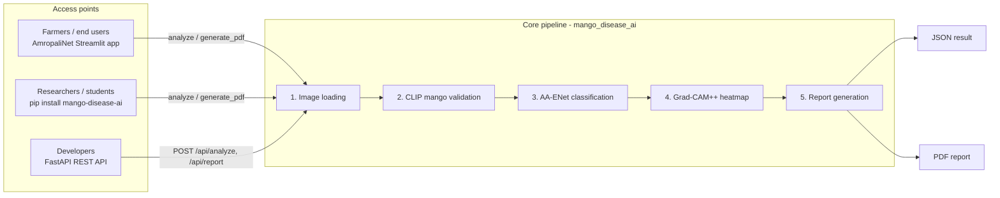

# mango-disease-ai: A Python Toolkit for Mango Disease Diagnosis

[](https://pypi.org/project/mango-disease-ai/)
[](https://www.python.org/downloads/)
[](LICENSE)
[](https://github.com/Arpon-30/UI-Changes-Mango/actions/workflows/tests.yml)
[](https://amropalinet.streamlit.app/)

**mango-disease-ai** is an open-source Python toolkit for classifying diseases of the
Amropali (Amrapali) mango fruit from a single photo. It ships the trained **AA-ENet** model
(EfficientNet-B0 + CBAM attention + Transformer encoder) and wraps it in:

- **CLIP zero-shot validation** that rejects photos that are not a mango,
- **7-class disease classification** with a full probability distribution,
- **Grad-CAM++ explanations** showing the image regions behind each prediction,
- a **disease encyclopedia** (scientific name, symptoms, remedies),
- **PDF diagnosis reports** (English; Bangla is added in the development version 0.2.0),
- a **FastAPI REST service** for developers, and
- **AmropaliNet**, a Streamlit web application for farmers and other non-technical users.

This repository is the single source for all three access points: the PyPI package, the
REST API and the AmropaliNet web application.

| | Link |
|---|---|
| Python package (PyPI) | https://pypi.org/project/mango-disease-ai/ |
| Web application (Streamlit) | https://amropalinet.streamlit.app/ |
| Source code (this repository) | https://github.com/Arpon-30/UI-Changes-Mango |
| Issue tracker | https://github.com/Arpon-30/UI-Changes-Mango/issues |

---

## Contents

1. [Statement of need](#1-statement-of-need)
2. [Features](#2-features)
3. [Software architecture](#3-software-architecture)
4. [Installation](#4-installation)
5. [Usage](#5-usage) - Python, REST API, web application
6. [Model, dataset and results](#6-model-dataset-and-results)
7. [Repository structure](#7-repository-structure)
8. [Versions and releases](#8-versions-and-releases)
9. [Testing](#9-testing)
10. [Limitations](#10-limitations)
11. [How to cite](#11-how-to-cite)
12. [Contributing and support](#12-contributing-and-support)
13. [Authors](#13-authors)
14. [License](#14-license)
15. [Acknowledgements](#15-acknowledgements)

---

## 1. Statement of need

Mango is one of the most important fruit crops of South Asia, and diseases such as
anthracnose, powdery mildew and bacterial canker reduce both yield and post-harvest
quality. Smallholder farmers rarely have access to plant-pathology expertise, and most
published mango disease classifiers remain research prototypes that cannot be installed,
reused or used by non-experts.

mango-disease-ai turns a trained, cultivar-specific classifier into reusable software:

- **Researchers and students** can run the trained model with one function call
  (`analyze()`), with no training or fine-tuning, and use it as a baseline for further work.
- **Developers** can add mango disease diagnosis to their own applications through the
  Python API or the REST API.
- **Farmers and extension workers** can use the AmropaliNet web application in a browser,
  in English or Bangla, without any programming.

The tool supports preliminary screening only. It does not replace expert or laboratory
diagnosis.

## 2. Features

| Feature | Description |
|---|---|
| Mango check | CLIP (`openai/clip-vit-base-patch32`) zero-shot validation rejects non-mango images before classification |
| 7 classes | Anthracnose, Bacterial Canker, Healthy, Powdery Mildew, Scab, Sooty Mould, Stem End Rot |
| Confidence | Top-1 class plus the probability of every class |
| Explainability | Grad-CAM++ heatmap of the regions that drove the prediction |
| Disease guidance | Scientific name, description, symptoms and remedies for each class |
| PDF report | One-page A4 report with the photo, heatmap, probabilities and guidance (Bangla from 0.2.0) |
| REST API | FastAPI service with interactive Swagger documentation at `/docs` |
| Web application | AmropaliNet (Streamlit), bilingual English / Bangla, light / dark theme, camera capture |
| CPU only | No GPU needed; the model has about 4.6 million parameters |

## 3. Software architecture

One shared core pipeline is exposed through three access points, so the diagnostic logic
is implemented once and reused everywhere.



| Module | Role |
|---|---|
| `mango_disease_ai/core.py` | `analyze()`: the full pipeline (validation, classification, Grad-CAM++) |
| `mango_disease_ai/model.py` | AA-ENet architecture, CBAM, weight loading, CLIP mango detector, disease information |
| `mango_disease_ai/inference.py` | Pre-processing, classification, Grad-CAM++ and affected-area marking |
| `mango_disease_ai/report.py`, `report_engine.py` | `generate_pdf()`: English / Bangla PDF reports (fpdf2) |
| `mango_disease_ai/server.py` | FastAPI REST API (`create_app()`, `mango-api` command) |
| `streamlit_app.py` | AmropaliNet on Streamlit Community Cloud |
| `api/main.py`, `run.py` | AmropaliNet website served locally on the library REST API |

## 4. Installation

Requirements: Python 3.10 or newer, about 2 GB of free RAM. Runs on Windows, Linux and
macOS, CPU only.

### From PyPI (recommended)

```bash
pip install mango-disease-ai
```

With the REST API server:

```bash
pip install "mango-disease-ai[api]"
```

### From source

```bash
git clone https://github.com/Arpon-30/UI-Changes-Mango.git
cd UI-Changes-Mango
pip install -e ".[api,dev]"
```

The trained AA-ENet weights (`mango_disease_ai/AA-ENet_proposed.pt`, 18 MB) are included
in the package and in this repository. The CLIP mango checker (about 600 MB) is
downloaded from Hugging Face on the first analysis and cached afterwards.

## 5. Usage

### 5.1 Python

```python
from mango_disease_ai import analyze, generate_pdf

result = analyze("mango.jpg")          # file path, bytes, PIL.Image or file object

if not result["is_mango"]:
    print("Not a mango photo")
else:
    print(result["predicted_class"], f"{result['confidence']:.1%}")
    for item in result["all_scores"]:
        print(f"  {item['class']:<18} {item['score']:.4f}")

    pdf_bytes = generate_pdf(result, user_name="Researcher")
    with open("report.pdf", "wb") as f:
        f.write(pdf_bytes)
```

Fast mode without the heatmap: `analyze("mango.jpg", include_gradcam=False)`.

Main fields of the result dictionary:

| Key | Meaning |
|---|---|
| `is_mango`, `mango_confidence` | Result of the CLIP mango check |
| `predicted_class`, `confidence` | Top class and its probability |
| `all_scores` | All 7 classes, highest first: `[{"class": ..., "score": ...}]` |
| `disease_info` | `scientific_name`, `description`, `symptoms`, `remedies` |
| `original_base64` | Input photo (JPEG, base64) |
| `gradcam_base64` | Grad-CAM++ heatmap overlay (JPEG, base64) |

More examples: [`how_to_use.py`](how_to_use.py), [`developer_workflow.py`](developer_workflow.py),
[`demo_run.py`](demo_run.py) and the package guide [`README_PACKAGE.md`](README_PACKAGE.md).

### 5.2 REST API

```bash
mango-api                    # or: python -m mango_disease_ai.server --port 8000
```

Open http://localhost:8000/docs for the interactive Swagger UI.

| Method | Endpoint | Function |
|---|---|---|
| GET | `/api/health` | Health check; server and model status |
| GET | `/api/diseases` | Information for all 7 classes |
| POST | `/api/analyze` | Upload `image`, receive the diagnosis as JSON |
| POST | `/api/report` | Upload `image` and `user_name`, receive a PDF report |

```bash
curl -F "image=@mango.jpg" http://localhost:8000/api/analyze
curl -F "image=@mango.jpg" -F "user_name=Researcher" http://localhost:8000/api/report -o report.pdf
```

Error codes: `400` invalid or too large file (limit 10 MB), `422` not a mango photo,
`500` processing error.

### 5.3 AmropaliNet web application

Online: **https://amropalinet.streamlit.app/** (no installation needed). Upload or take a
photo of a mango, then view the predicted disease, the probabilities, the symptoms and
treatment, the Grad-CAM++ heatmap, and download the PDF report. Add `?demo=1` to the link
to see a sample result without a photo.

Run it locally:

```bash
pip install -r api/requirements.txt
python run.py                      # website on the REST API, http://localhost:8000
# or
pip install -r requirements.txt
streamlit run streamlit_app.py     # the Streamlit version
```

Deployment options (Streamlit Community Cloud, Docker, Hugging Face Spaces) are described
in [`DEPLOY.md`](DEPLOY.md).

## 6. Model, dataset and results

**AA-ENet** (Attention-Augmented EfficientNet) combines an EfficientNet-B0 backbone, a
Convolutional Block Attention Module (CBAM) and a compact Transformer encoder. Input size
is 224 x 224 with ImageNet normalisation.

**Dataset:** 3,500 curated images of the Amropali Mango Fruit Diseases Dataset, seven
balanced classes (500 images per class).

Test-set results reported in the accompanying SoftwareX manuscript:

| Model | Params (M) | Accuracy (%) | Precision | Recall | F1-score |
|---|---|---|---|---|---|
| VGG16 | 134.29 | 95.62 | 0.9562 | 0.9562 | 0.9560 |
| InceptionV3 | 21.80 | 95.62 | 0.9562 | 0.9562 | 0.9562 |
| Xception | 20.82 | 96.76 | 0.9681 | 0.9676 | 0.9676 |
| MobileNetV3 | 4.21 | 96.19 | 0.9653 | 0.9619 | 0.9619 |
| EfficientNet-B0 | 4.02 | 96.38 | 0.9644 | 0.9638 | 0.9639 |
| **AA-ENet (ours)** | **4.57** | **96.76** | **0.9681** | **0.9676** | **0.9676** |

The training notebook is [`last-try-mango.ipynb`](last-try-mango.ipynb).

## 7. Repository structure

```
├── mango_disease_ai/        # The Python package published on PyPI
│   ├── core.py              #   analyze() - full pipeline
│   ├── model.py             #   AA-ENet, CBAM, CLIP detector, disease information
│   ├── inference.py         #   classification, Grad-CAM++
│   ├── report.py            #   generate_pdf()
│   ├── report_engine.py     #   PDF layout (English / Bangla)
│   ├── server.py            #   FastAPI REST API (mango-api)
│   ├── AA-ENet_proposed.pt  #   trained weights (18 MB)
│   └── fonts/               #   Hind Siliguri (OFL) for Bangla PDFs
├── streamlit_app.py         # AmropaliNet on Streamlit Community Cloud
├── requirements.txt         # Streamlit Cloud dependencies
├── api/                     # Website on the library REST API (python run.py)
├── templates/, static/      # AmropaliNet website (HTML, CSS, JavaScript, images)
├── run.py                   # One-click local start of the website
├── tests/                   # Automated tests (pytest)
├── docs/                    # Bilingual project documentation (PDF)
├── how_to_use.py, developer_workflow.py, demo_run.py, use_me.py   # Usage examples
├── last-try-mango.ipynb     # Model training notebook
├── pyproject.toml           # Package metadata and dependencies
├── Dockerfile               # Container build (Hugging Face Spaces / Docker)
├── CITATION.cff             # Citation metadata
├── CHANGELOG.md             # Version history
├── CONTRIBUTING.md          # Contribution guidelines
└── LICENSE                  # MIT License
```

## 8. Versions and releases

| Version | Where | Notes |
|---|---|---|
| **0.1.3** | [PyPI](https://pypi.org/project/mango-disease-ai/0.1.3/), git tag `v0.1.3` | Latest PyPI release (20 Sep 2026). Version described in the SoftwareX article |
| 0.2.0 (development) | `main` branch | Runs the AmropaliNet web application; adds Bangla PDF reports and affected-area marking. Not yet on PyPI |

See [`CHANGELOG.md`](CHANGELOG.md) for details. To install the exact version described in
the article:

```bash
pip install mango-disease-ai==0.1.3
```

## 9. Testing

Automated tests run with `pytest` on every push and pull request through GitHub Actions
([`.github/workflows/tests.yml`](.github/workflows/tests.yml)).

```bash
pip install -e ".[api,dev]"
pytest
```

The tests check the package import, the disease information, loading of the bundled AA-ENet
weights and a forward pass, PDF report generation, and the REST API endpoints. They do not
download the CLIP model, so they run quickly.

## 10. Limitations

- Trained and evaluated on one cultivar (Amropali) and on curated images; accuracy on
  field photos and other cultivars has not yet been measured.
- The CLIP mango check can wrongly accept or reject unusual photos.
- Grad-CAM++ heatmaps indicate where the model looked; they are not a measure of disease
  severity.
- Results are a preliminary screening aid, not a replacement for expert or laboratory
  diagnosis.

## 11. How to cite

If you use this software, please cite it. Citation metadata is in
[`CITATION.cff`](CITATION.cff) (GitHub shows it under **"Cite this repository"**).

```bibtex
@software{mango_disease_ai,
  author  = {Amit, Arpon Paul and Oni, Saiful Islam and Ibtihazzaman, Md and
             Shahriar, SM Fahim and Miah, Md. Saef Ullah},
  title   = {mango-disease-ai: A Python Toolkit for Mango Disease Diagnosis},
  version = {0.1.3},
  year    = {2026},
  url     = {https://github.com/Arpon-30/UI-Changes-Mango}
}
```

## 12. Contributing and support

Bug reports, questions and pull requests are welcome; see
[`CONTRIBUTING.md`](CONTRIBUTING.md).

- Issues: https://github.com/Arpon-30/UI-Changes-Mango/issues
- Support email: 23-50158-1@student.aiub.edu

## 13. Authors

Department of Computer Science, American International University-Bangladesh (AIUB),
Dhaka, Bangladesh.

- Arpon Paul Amit - 23-50158-1@student.aiub.edu
- Saiful Islam Oni - 26-94253-3@student.aiub.edu
- Md Ibtihazzaman - 22-49153-3@student.aiub.edu
- SM Fahim Shahriar - 23-50114-1@student.aiub.edu
- Md. Saef Ullah Miah (supervisor) - saef@aiub.edu

## 14. License

The source code and the trained model weights are released under the
[MIT License](LICENSE).

Third-party components: the Hind Siliguri font in `mango_disease_ai/fonts` is under the
SIL Open Font License 1.1 ([`OFL.txt`](mango_disease_ai/fonts/OFL.txt)). The CLIP model
(`openai/clip-vit-base-patch32`) is downloaded from Hugging Face at run time under its own
licence and is not redistributed here.

## 15. Acknowledgements

The authors thank American International University-Bangladesh (AIUB) and the AIUB R&D
ICCA Research Group for supporting this work.
